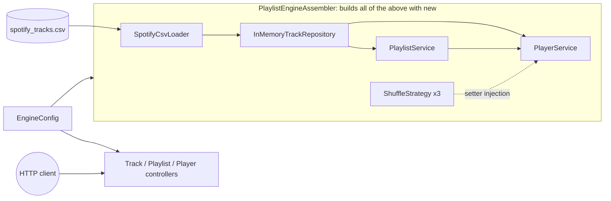

# fundermentals: a music library and playlist engine

A Java 21 project that loads ~90,000 real Spotify tracks and builds a playlist engine on top of them:
playlists and rule-based smart playlists, undo/redo, a player with a Play Next queue, shuffle strategies
and repeat modes, all served through a REST API.

The point of it is **core Java, done by hand**: the linked lists, stacks, queues and iterators are written
from scratch rather than taken from `java.util`, the objects are wired together without a DI framework,
and Spring Boot appears only at the very edge, as the web layer.

> **Status:** complete and tested (576 tests). See [Possible next steps](#possible-next-steps) for ideas beyond this.

## Contents

- [What it does](#what-it-does)
- [How it fits together](#how-it-fits-together)
- [Where each concept lives](#where-each-concept-lives)
- [Design decisions](#design-decisions)
- [Getting started](#getting-started)
- [Using the API](#using-the-api)
- [Testing](#testing)
- [Project layout](#project-layout)
- [Possible next steps](#possible-next-steps)

---

## What it does

- **Library:** loads the Spotify Tracks dataset from CSV (skipping and logging bad or duplicate rows), then
  searches it, sorts it and finds the most popular tracks.
- **Playlists:** create, rename, delete; add, remove and move tracks; **undo and redo** every edit.
- **Smart playlists:** filled automatically by a rule, such as "genre is jazz" or "tempo 120 to 130 BPM",
  and refused anything that doesn't match.
- **Player:** play, next, previous (like a browser's back and forward), a **Play Next** queue,
  "up next" and "recently played", three **shuffle** strategies (in order, random, weighted by popularity)
  and three **repeat** modes (off, all, one).
- **REST API** over all of it, with consistent JSON errors.

---

## How it fits together



- Everything inside the box is **plain Java**. No class there imports Spring.
- [`PlaylistEngineAssembler`](src/main/java/com/khanyi/java/fundermentals/wiring/PlaylistEngineAssembler.java) is the **composition root**: the one place
  that calls `new` on the engine's classes and hands each its dependencies. Reading its constructor top to
  bottom is reading the whole object graph.
- Spring sees exactly **one** engine bean (the assembler, from [`EngineConfig`](src/main/java/com/khanyi/java/fundermentals/web/EngineConfig.java)).
  The controllers take the services out of it. A test checks that Spring has no `PlaylistService` or
  `PlayerService` bean of its own.

---

## Where each concept lives

### Object-oriented design

| Concept | Where |
|---|---|
| Abstract class with a template | [`MediaItem`](src/main/java/com/khanyi/java/fundermentals/model/MediaItem.java): `getDisplayName()` is built on the abstract `getCreator()` |
| Inheritance and polymorphism | [`Track`](src/main/java/com/khanyi/java/fundermentals/model/Track.java) and [`PodcastEpisode`](src/main/java/com/khanyi/java/fundermentals/model/PodcastEpisode.java) extend `MediaItem`; a playlist holds either |
| Overriding a parent's behaviour | `PodcastEpisode.getDisplayName()` ("Show #3 - Title"); `SmartPlaylist.checkCanAdd()` |
| Inheritance that keeps the parent's promises (Liskov) | [`SmartPlaylist`](src/main/java/com/khanyi/java/fundermentals/model/SmartPlaylist.java) only narrows *which* items are accepted, through a documented hook in [`Playlist`](src/main/java/com/khanyi/java/fundermentals/model/Playlist.java) |
| Composition over inheritance | [`LinkedStack`](src/main/java/com/khanyi/java/fundermentals/datastructures/LinkedStack.java) and [`LinkedQueue`](src/main/java/com/khanyi/java/fundermentals/datastructures/LinkedQueue.java) *contain* a `DoublyLinkedList` rather than extend it |
| Immutability | `MediaItem`, `Track`, `PodcastEpisode`: `final` fields, validated in the constructor, no setters |
| `equals`/`hashCode` done properly | `MediaItem`: by id and exact class, `final` so subclasses can't break it; `Playlist` deliberately keeps identity equality because it's mutable |
| Enums with behaviour | [`RepeatMode`](src/main/java/com/khanyi/java/fundermentals/service/RepeatMode.java): `next()` cycles OFF → ALL → ONE |
| Records | Request and response bodies in [`ApiRequests`](src/main/java/com/khanyi/java/fundermentals/web/ApiRequests.java) and [`ApiResponses`](src/main/java/com/khanyi/java/fundermentals/web/ApiResponses.java); a private `record Keyed` inside [`WeightedByPopularityShuffle`](src/main/java/com/khanyi/java/fundermentals/service/WeightedByPopularityShuffle.java) |

### Interfaces

| Concept | Where |
|---|---|
| An interface for the contract, a class for the implementation | `Stack` → `LinkedStack`, `Queue` → `LinkedQueue`, `PositionalList` → `LinkedPositionalList`, `Repository` → `InMemoryTrackRepository`, `DataSetLoader` → `SpotifyCsvLoader` |
| `default` methods built on one abstract method | [`Playable`](src/main/java/com/khanyi/java/fundermentals/model/Playable.java)`.formattedDuration()`, [`Searchable`](src/main/java/com/khanyi/java/fundermentals/model/Searchable.java)`.matches()`, [`Repository`](src/main/java/com/khanyi/java/fundermentals/data/Repository.java)`.getById()`, [`DataSetLoader`](src/main/java/com/khanyi/java/fundermentals/data/DataSetLoader.java)`.load(Path)` |
| `static` interface methods | `Searchable.containsIgnoreCase()` |
| Functional interfaces and lambdas | [`ShuffleStrategy`](src/main/java/com/khanyi/java/fundermentals/service/ShuffleStrategy.java) (`@FunctionalInterface`); `Predicate` rules in `SmartPlaylist`; `Supplier<String>` id generator in [`PlaylistService`](src/main/java/com/khanyi/java/fundermentals/service/PlaylistService.java) |

### Generics

| Concept | Where |
|---|---|
| Generic types | `DoublyLinkedList<E>`, `PositionalList<E>`, `Repository<T, ID>`, `DataSetLoader<T>` |
| Bounded wildcards (PECS: producer `extends`, consumer `super`) | [`FilteringIterator`](src/main/java/com/khanyi/java/fundermentals/datastructures/FilteringIterator.java): `Iterator<? extends E>` and `Predicate<? super E>`; `Comparator<? super Track>` in `InMemoryTrackRepository.sorted()` |
| Generic methods | `PlaylistService.register()` returns the same subtype it was given |

### Exceptions

| Exception | Kind | Why |
|---|---|---|
| [`MalformedRecordException`](src/main/java/com/khanyi/java/fundermentals/data/MalformedRecordException.java) | **checked** | Bad input data is *expected*; the compiler makes the loader decide what to do (it skips the row and logs it) |
| [`TrackNotFoundException`](src/main/java/com/khanyi/java/fundermentals/data/TrackNotFoundException.java) | unchecked, extends `NoSuchElementException` | Asking for a missing id; the web layer turns every `NoSuchElementException` into a 404 |
| [`EmptyCollectionException`](src/main/java/com/khanyi/java/fundermentals/datastructures/EmptyCollectionException.java) | unchecked | Popping an empty stack is a bug in the caller |
| `IllegalArgumentException` / `IllegalStateException` | unchecked | Bad argument (→ 400) vs right request at the wrong time, e.g. "Nothing to undo" (→ 409) |

Other details: exception chaining (the original `IOException` kept as the cause), try-with-resources in
`DataSetLoader.load(Path)`, and `UncheckedIOException` unwrapped back into `IOException` in [`SpotifyCsvLoader`](src/main/java/com/khanyi/java/fundermentals/data/SpotifyCsvLoader.java).

### Data structures and iterators (all hand-written)

| Structure | Where | Used for |
|---|---|---|
| Doubly linked list with sentinel nodes | [`DoublyLinkedList`](src/main/java/com/khanyi/java/fundermentals/datastructures/DoublyLinkedList.java) | The base of the stack and queue |
| Positional list (the Position ADT) | [`LinkedPositionalList`](src/main/java/com/khanyi/java/fundermentals/datastructures/LinkedPositionalList.java) | A playlist's items: insert, remove and move by relinking nodes |
| Stack | [`LinkedStack`](src/main/java/com/khanyi/java/fundermentals/datastructures/LinkedStack.java) | Undo and redo; the player's back and forward history |
| Queue | [`LinkedQueue`](src/main/java/com/khanyi/java/fundermentals/datastructures/LinkedQueue.java) | The Play Next queue |
| Filtering iterator (Decorator) | [`FilteringIterator`](src/main/java/com/khanyi/java/fundermentals/datastructures/FilteringIterator.java) | Filling smart playlists with matching tracks |
| Repeating iterator (Decorator) | [`RepeatingIterator`](src/main/java/com/khanyi/java/fundermentals/datastructures/RepeatingIterator.java) | "Up next" with repeat ALL, which wraps round forever |
| Inner-class iterators | Inside `DoublyLinkedList` and `LinkedPositionalList`, with working `remove()` | |

The two decorator iterators can be stacked: a filtered, endlessly repeating playlist is
`new FilteringIterator<>(RepeatingIterator.forever(list), rule)`.

### Design patterns

| Pattern | Where |
|---|---|
| Builder | `Track.Builder` (a track has 12 fields) |
| Template Method | `Searchable.matches()` + `searchableFields()`; `Playlist.insert()` + the `checkCanAdd()` hook |
| Decorator | `FilteringIterator`, `RepeatingIterator` |
| Command | [`PlaylistEdit`](src/main/java/com/khanyi/java/fundermentals/service/PlaylistEdit.java) and its `AddItemEdit`, `RemoveItemEdit`, `MoveItemEdit`, run by [`EditHistory`](src/main/java/com/khanyi/java/fundermentals/service/EditHistory.java) on two stacks |
| Strategy | `ShuffleStrategy`: [`InOrderStrategy`](src/main/java/com/khanyi/java/fundermentals/service/InOrderStrategy.java), [`RandomShuffle`](src/main/java/com/khanyi/java/fundermentals/service/RandomShuffle.java), `WeightedByPopularityShuffle` |
| Null Object | `InOrderStrategy`, the "no shuffle" shuffle, so the player never checks for `null` |
| Static factory methods | `RepeatingIterator.forever()`/`times()`, `SmartPlaylist.byGenre()`/`byTempo()`, `PlaylistEngineAssembler.fromSpotifyCsv()` |
| Composition root | `PlaylistEngineAssembler` |
| DTO | The records in `ApiRequests` and `ApiResponses` |

### Dependency injection, by hand

| Kind | Where |
|---|---|
| Constructor injection | `PlaylistService(Repository, Supplier<String>)`, `PlayerService(PlaylistService, Repository)`, `RandomShuffle(Random)` |
| Setter injection | `PlayerService.setShuffleStrategy()`: the strategy can change while the app runs |
| Injecting randomness | Every shuffle takes a `Random`, so a test can pass `new Random(42)` and get the same order every time |
| Injecting the id generator | `PlaylistService` takes a `Supplier<String>`: UUIDs in the app, `p1`, `p2`, ... in tests |

### Algorithms

| Algorithm | Where |
|---|---|
| Fisher–Yates shuffle, O(n), every order equally likely | `RandomShuffle` |
| Weighted random ordering (Efraimidis–Spirakis): key `u^(1/w)`, sorted, O(n log n) | `WeightedByPopularityShuffle` |
| Walking from the nearer end to reach index *i* | `Playlist.positionAt()` |
| Hash index next to an ordered list: O(1) lookup by id, load order kept | `InMemoryTrackRepository` |

### Web layer (Spring Boot)

| Concept | Where |
|---|---|
| Thin controllers that only translate HTTP ↔ engine calls | [`TrackController`](src/main/java/com/khanyi/java/fundermentals/web/TrackController.java), [`PlaylistController`](src/main/java/com/khanyi/java/fundermentals/web/PlaylistController.java), [`PlayerController`](src/main/java/com/khanyi/java/fundermentals/web/PlayerController.java) |
| One place that maps exceptions to status codes, as `ProblemDetail` JSON | [`ApiExceptionHandler`](src/main/java/com/khanyi/java/fundermentals/web/ApiExceptionHandler.java) |
| Configuration instead of hard-coded paths | `fundermentals.dataset` in `application.properties`, read with `@Value` |
| Thread safety | `synchronized (engine)` around every playlist and player operation (see below) |

---

## Design decisions

**Why write data structures that `java.util` already has?** Because the structure *is* the subject.
A playlist built on a positional list can move a track by unlinking and relinking a node, with no shifting
of the elements behind it. Undo and redo are two stacks. The Play Next queue is a queue. Each structure is
used where its behaviour fits, and `java.util` is still used where it isn't the point (the repository's
`ArrayList` and `HashMap`, for example).

**Why wire everything by hand instead of letting Spring do it?** So the dependency injection is visible.
`@Autowired` makes wiring happen invisibly; here you can read it, in order, in one constructor. It also keeps
the engine free of framework code: the same engine could sit behind a command-line app without changes.

**Why one coarse lock?** Spring serves requests on many threads, but the engine uses plain collections.
Every controller method that touches playlists or the player locks the one shared assembler, so only one such
request runs at a time. Each operation is in memory and takes microseconds, so correctness matters more than
throughput here. Finer locks (per playlist, or read/write locks) would be the next step if it ever mattered.
Track searches don't lock at all: nothing writes to the library after startup.

**Why records for the API instead of returning domain objects?** So the JSON is a deliberate contract.
Renaming a getter in `Track` can't silently change the API, durations are sent as `"3:00"` rather than
`"PT3M"`, and nothing is exposed by accident.

**Why does a smart playlist refuse non-matching tracks instead of ignoring them?** Silently dropping an
item would surprise the caller. Throwing `IllegalArgumentException` with the rule in the message
("'Charlie' doesn't match this playlist's rule: genre is jazz") tells them exactly why, and becomes a clear 400.

**Why does undo use the Command pattern?** Each edit is an object that knows how to do *and undo* itself,
so `EditHistory` only needs two stacks and never needs to know what kind of edit it holds. A new edit type
needs no change to the history.

**Why is an edit recorded only after it succeeds?** `EditHistory.perform()` runs the
edit first and pushes it only if nothing was thrown, so a failed edit can never be "undone".

---

## Getting started

### 1. Prerequisites

- **JDK 21** or newer.
- **Maven is not needed:** the project ships with the Maven wrapper (`./mvnw`).

### 2. Download the dataset

The dataset is **not** in this repository (it's 20 MB and gitignored). The code expects it at:

```
data/spotify_tracks.csv
```

**Option A: command line** (from the project root)

```bash
mkdir -p data
curl -L -o data/spotify_tracks.csv \
  https://huggingface.co/datasets/maharshipandya/spotify-tracks-dataset/resolve/main/dataset.csv
```

**Option B: by hand**

1. Download `dataset.csv` from the
   [Spotify Tracks Dataset on Hugging Face](https://huggingface.co/datasets/maharshipandya/spotify-tracks-dataset)
   (*Files and versions* tab).
2. Create a folder called `data` in the project root, next to `pom.xml`.
3. Move the file into it and rename it to **`spotify_tracks.csv`**.

**Check it:** the file should be about 20 MB with 114,001 lines (a header plus 114,000 rows):

```bash
wc -l data/spotify_tracks.csv     # 114001 data/spotify_tracks.csv
```

When loaded, it gives **89,740 tracks**. The rest are skipped on purpose, and the loader logs why:
24,259 rows repeat a track id that's already loaded (the same song listed under several genres),
and 1 row has a blank title.

The dataset was published by Maharshi Pandya (originally on Kaggle). See the dataset page for its terms of use.

### 3. Build and run the tests

```bash
./mvnw test
```

The tests pass without the real dataset (see [Testing](#testing)).

### 4. Run the app

```bash
./mvnw spring-boot:run
```

It loads the dataset (about half a second) and listens on `http://localhost:8080`.
If `data/spotify_tracks.csv` is missing it stops straight away and says so.
To use a CSV somewhere else, set `fundermentals.dataset` (in `application.properties` or with
`--fundermentals.dataset=/path/to/file.csv`).

### In IntelliJ IDEA

1. **File → Open** and choose the project folder (the one with `pom.xml`).
2. If imports show red, open the **Maven** tool window and click **Reload All Maven Projects**.
3. Right-click `src/test/java` and choose **Run 'All Tests'**.
4. To start the app, run `FundermentalsApplication` (the green arrow next to `main`).

---

## Using the API

All responses are JSON. Errors use the standard `ProblemDetail` format, for example
`{"status": 404, "title": "Not Found", "detail": "No playlist with id 'x'"}`:
**404** for an unknown id, **400** for bad input, **409** when an action doesn't fit the current state ("Nothing to undo").

| Method and path | Body | What it does |
|---|---|---|
| `GET /api/tracks?q=adele&limit=20` | | Search titles, artists, albums and genres (limit 1–100) |
| `GET /api/tracks/top?limit=10` | | Most popular tracks |
| `GET /api/tracks/{id}` | | One track |
| `GET /api/playlists` | | All playlists |
| `POST /api/playlists` | `{"name"}` | New empty playlist (201) |
| `POST /api/playlists/genre` | `{"name", "genre", "limit"}` | Smart playlist: most popular tracks in a genre |
| `POST /api/playlists/tempo` | `{"name", "minBpm", "maxBpm", "limit"}` | Smart playlist: tracks in a tempo range |
| `GET`, `PATCH`, `DELETE /api/playlists/{id}` | `{"name"}` for PATCH | Read, rename, delete |
| `POST /api/playlists/{id}/tracks` | `{"trackId", "index"?}` | Add a track (at the end, or at `index`) |
| `DELETE /api/playlists/{id}/items/{index}` | | Remove an item |
| `POST /api/playlists/{id}/moves` | `{"from", "to"}` | Move an item |
| `POST /api/playlists/{id}/undo`, `/redo` | | Undo or redo the last edit |
| `GET /api/playlists/{id}/history` | | What undo and redo would do next |
| `POST /api/playlists/{id}/refresh` | | Refill a smart playlist |
| `GET /api/player` | | Now playing, up next, recently played, shuffle, repeat |
| `POST /api/player/play/{playlistId}` | | Start a playlist |
| `POST /api/player/next`, `/previous`, `/finished` | | Skip, go back, or "the song ended" |
| `POST /api/player/queue` | `{"trackId"}` | Play Next |
| `PUT /api/player/shuffle` | `{"strategy"}` | `in-order`, `random` or `weighted` |
| `PUT /api/player/repeat` | `{"mode"}` | `off`, `all` or `one` |

A short session with `curl`:

```bash
# a smart playlist of the 5 most popular jazz tracks
curl -s -X POST localhost:8080/api/playlists/genre \
  -H 'Content-Type: application/json' -d '{"name": "Jazz", "genre": "jazz", "limit": 5}'
# -> {"id": "390bf73b-...", "name": "Jazz", "smart": true, "rule": "genre is jazz", "size": 5, ...}

# shuffle weighted by popularity, then play it (use the id from above)
curl -s -X PUT localhost:8080/api/player/shuffle \
  -H 'Content-Type: application/json' -d '{"strategy": "weighted"}'
curl -s -X POST localhost:8080/api/player/play/390bf73b-...
```

---

## Testing

```bash
./mvnw test
```

**576 tests in 36 test classes**, all JUnit 5. They pass without the 20 MB dataset: a 7-row sample CSV in
`src/test/resources` covers the loader, and the 6 tests that use the real file are skipped with `assumeTrue`
when it's missing.

| Kind | Examples |
|---|---|
| Unit tests for every class | One test class per production class, mirroring the package layout |
| Parameterised tests | 12 kinds of bad CSV row in `SpotifyCsvLoaderTest`; bad limits in `TrackControllerTest` |
| Contract tests | `ShuffleStrategyContractTest` runs the same rules (same items, same count, input untouched) against every strategy |
| Statistical tests | Fisher–Yates gives each of the 6 orders of 3 items about 1/6 of the time over 60,000 runs; the weighted shuffle puts an item first with probability weight / total |
| Deterministic randomness | A seeded `Random` makes shuffles and whole-engine runs repeatable |
| Log checks | Logback's `ListAppender` captures log lines (skipped rows, undo history) and asserts on them |
| Controller tests | MockMvc around the real controllers and error handler, with a fresh engine per test |
| Spring wiring test | `@SpringBootTest` on the sample CSV: one engine bean, no service beans, errors as `ProblemDetail` |
| Real-dataset tests | 89,740 tracks loaded, playlists built and played from the real data |

---

## Project layout

```
src/main/java/com/khanyi/java/fundermentals/
├── datastructures/   linked list, positional list, stack, queue, custom iterators
├── model/            MediaItem, Track, PodcastEpisode, Playlist, SmartPlaylist
├── data/             CSV loader, Repository<T, ID>, in-memory track repository
├── service/          undo/redo (Command), PlaylistService, shuffle strategies, PlayerService
├── wiring/           PlaylistEngineAssembler: creates every object and connects them (no Spring)
└── web/              REST controllers, request/response records, error handling (the only Spring code)
```

---

## Possible next steps

- Finer-grained locking (one lock per playlist) if many users edited at once.
- Saving playlists to disk or a database: a new `Repository` implementation, with only the assembler changing.
- Endpoints for podcast episodes, which the model already supports.
- OpenAPI documentation for the API, and a CI workflow that runs `./mvnw test` on every push.
